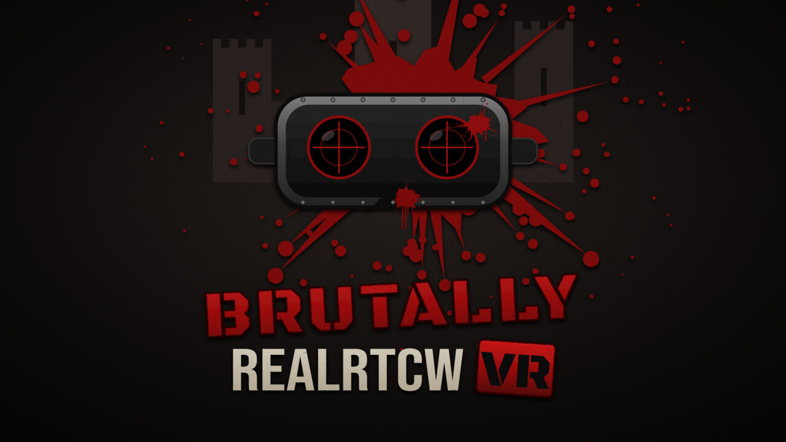

# Brutally RealRTCW VR



**Brutally RealRTCW VR** is a free mod for RealRTCW that lets you play Return to Castle Wolfenstein in PC VR through OpenXR, with extra gore, dual wielding and a pile of fixes for the flatscreen game too. You need RealRTCW on Steam.

Download it below or from ModDB. This repository also holds the full source.

---

## Features

### VR
- Native OpenXR rendering, room-scale, seated or standing, with a height offset.
- Hand-held guns with life-like sizes, HD first person arms with wrists and elbows joined to BJ's body, and both hands matching on every gun.
- Two-handed rifles and SMGs, working bolts, slides that cycle and lock back, and hand reloading with magazines and spent cases.
- Weapon wheel on the right grip, in pages, with binoculars, quick save and quick load.
- Dual wielding, with a magazine and aiming dot for each gun.
- Grenades and thrown knives that land on the aiming dot, or real throws if you prefer.
- Mounted MG42s and flak guns, doors and buttons you push with your hand, and cutscenes on a flat screen in front of you.
- Controls built off the RTCWQuest layout, remappable in `game\main\vr_controls.cfg`.
- VR OPTIONS and GORE & EXTRAS menus, also in the pause menu.
- Cursed Sands playable in VR.

### Gore
- Headshots that open the skull or take the jaw off, explosions that strip bodies down, guts from knife and close-range shotgun hits, and bleeding stumps.
- Heavier ragdolls that you can grab and throw.

### Flatscreen
- Dual wielding, full body (look down to see your legs), and experimental aim down sights (`cg_flatADS 1`).

---

## Download

**[Download the latest version (October 10 update)](https://github.com/SkarKasm/Brutally-RealRTCW-VR/raw/main/download/Brutally_RealRTCW_VR_SP_2026-10-10.zip)** · [What's new](download/CHANGES_2026-10-10.md)

Also on ModDB.

---

## Installing

1. Install RealRTCW from Steam.
2. Download the zip above or from ModDB.
3. Extract it into your RealRTCW folder (normally `...\steamapps\common\RealRTCW`) and overwrite when asked.
4. Start `RealRTCW VR.bat`, or `RealRTCW (no VR).bat` for flatscreen. Cursed Sands has its own two launchers.

Your saves and settings are kept.

---

## Building

The mod builds like RealRTCW (see the `HOWTO-Build` files). For a Windows build from Linux with MinGW:

```
# game DLLs (cgame, qagame, ui)
make PLATFORM=mingw64 ARCH=x86_64 BUILD_CLIENT=0 BUILD_SERVER=0 BUILD_GAME_QVM=0 BUILD_BSPC=0 \
     BUILD_RENDERER_OPENGL2=0 release CC=x86_64-w64-mingw32-gcc CXX=x86_64-w64-mingw32-g++ \
     WINDRES=x86_64-w64-mingw32-windres LIBS="-lws2_32 -lwinmm -lpsapi -static -lpthread"

# game exe with OpenXR (needs the OpenXR and FFmpeg headers and libs on CPATH / LIBRARY_PATH)
make PLATFORM=mingw64 ARCH=x86_64 BUILD_SERVER=0 BUILD_GAME_SO=0 BUILD_GAME_QVM=0 BUILD_BSPC=0 \
     BUILD_RENDERER_OPENGL2=0 release
```

The VR code lives mainly in `code/client/cl_vr.c`, `code/cgame/cg_vr.c`, `code/game/g_vr.c` and `code/game/bg_vr.c`. The scripts in `misc/vr/` build `z_vr_assets.pk3` (hand models, weapon tables, menus, wheel icons) from your own RealRTCW install, so no game assets are stored here.

---

## Credits

- **RealRTCW** by WolfETPlayer and contributors, which this mod is built on.
- **iortcw** and id Software's RTCW source release.
- **RTCWQuest** by Team Beef (DrBeef), whose control layout the VR controls are based on.

## Support

Brutally RealRTCW VR is free and always will be. If you want to say thanks, you can buy me a coffee: https://buymeacoffee.com/mrskarkasm

## License

GPL v3, like RealRTCW and iortcw. See `COPYING.txt`.

---

# About RealRTCW

**RealRTCW** is a community-driven single-player overhaul for **Return to Castle Wolfenstein**, built on top of the original **iortcw** and **rtcw-sp** source code.

The project focuses on modernizing the engine, expanding gameplay systems, and improving overall stability and quality of life—while staying true to the original RTCW experience.

---

## ✨ Features

### Engine & Platform
- Full **iortcw feature set**, including proper widescreen support
- SDL3 backend
- **Steam integration** via *Steamshim* (by Ryan C. Gordon)
- Steam Achievements and Steam Stats support
- Steam Workshop Integration
- Steam Rich Presence support
- **FFmpeg** video playback support  
- Increased engine limits  
- Custom **BSPC** and **BSPCUI** tools
- Foliage rendering system
- Atmospheric environmental effects
- Extended scripting functionality
- Automatic AI attribute system (`.aidefaults`)   
- Expanded `.weap` file system    

### Gameplay & Content
- Expanded weapon arsenal  
- Survival game mode
- Restored console ports content and features
- Modular HUD system

### Usability & Quality of Life
- Subtitles support
- Weapon wheel
- Improved localization system  
- Enhanced controller/gamepad support
- Aim assist for gamepads
- `.pk3` gating via CVARs  
- Numerous bug fixes and general QoL improvements  

---

## 📄 Original README

The original id Software README that accompanied the RTCW source release is preserved as **`README.txt`** and can be found in the source tree for both the SP and MP codebases.

---

## 📦 Availability

- **ModDB**  
  https://www.moddb.com/mods/realrtcw-realism-mod

- **Steam**  
  https://store.steampowered.com/app/1379630/RealRTCW/

- **GOG**  
  https://www.gog.com/en/game/realrtcw

---

## 🐧 Linux Packages

- **Arch Linux (AUR)** – maintained by *M0Rf30*  
  https://aur.archlinux.org/packages/realrtcw/

- **openSUSE**  
  https://build.opensuse.org/package/show/games/realrtcw
